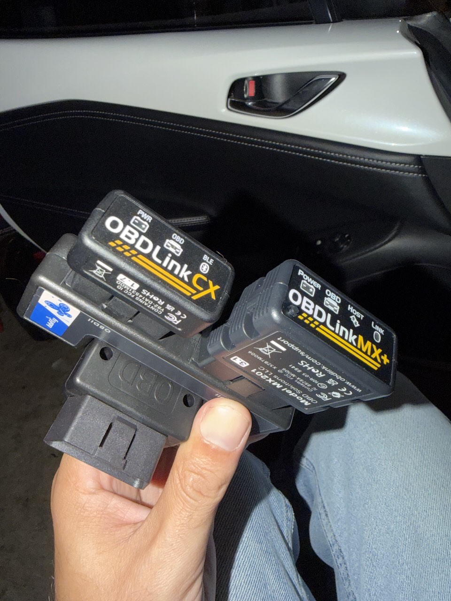
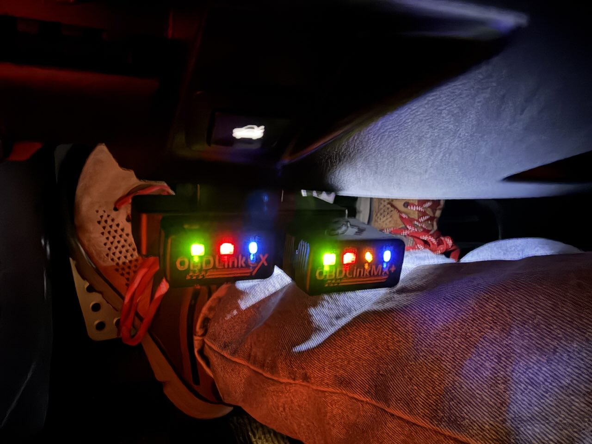

# mx5-miata-nd2-obd-can

## Telemetry Data for the ND2 MX-5 Miata

Documentation of what I've discovered on the CAN bus of the ND2 MX-5 Miata, packaged as a [RaceChrono](https://racechrono.com/) vehicle profile for track telemetry.

The profile is **CAN-only**: a single CAN-capable OBD adapter in RaceChrono's CAN-Bus (listen-only) mode. It no longer uses any OBD-II PID polling. Passive CAN logging is much faster than OBD-II polling: most channels update at 50–100 Hz, versus a few Hz per PID over OBD-II.

All testing was performed on:

* 2020 US MX-5 Miata soft top 2.0 (ND2)
* 2021 US MX-5 Miata RF 2.0 (ND2)

## Hardware

Any adapter that RaceChrono supports as a **CAN-Bus reader** works. The car's main CAN bus (500 kbit/s, 11-bit IDs) is on OBD pins 6/14. Tested:

* vLinker FS USB (STN1170 chip, reports itself as `vLinker FS r2`)
* [OBDLink CX](https://www.obdlink.com/products/obdlink-cx/) / [OBDLink MX+](https://www.obdlink.com/products/obdlink-mxp/)

In RaceChrono, add the adapter with **"Add other device" → CAN-Bus reader**, not "Add OBD-II reader".

## Importing the profile

The profile is in [`RaceChrono/vehicleProfile.json`](RaceChrono/vehicleProfile.json). Zip the `vehicleProfile.json` file and rename the zip to `car.rcz` to import it into RaceChrono.

## CAN Data Channels

`PID` is the CAN ID in decimal, which is what RaceChrono expects. RaceChrono's bit functions number bit 0 as the most significant bit of byte 0. Byte letters: `A` = byte 0, `B` = byte 1, … `H` = byte 7.

**Status** is either *Verified*, meaning checked against OBD-II ground truth or physical tests, or *Experimental*, meaning the signal and ID are confirmed but the scale or sign still needs checking on a drive (see [below](#verifying-the-experimental-channels)).

| Channel | PID | Units | RaceChrono Equation | Rate | Status | Notes |
| --- | --- | --- | --- | --- | --- | --- |
| Engine RPM | `514` (0x202) | `RPM` | `bytesToUInt(raw, 0, 2) / 4` | 100 Hz | Verified | |
| Speed | `514` (0x202) | `m/s` | `bytesToUInt(raw, 2, 2) / 360.0` | 100 Hz | Verified | Raw value is 0.01 km/h. |
| Accelerator Pedal Position | `514` (0x202) | `%` | `E / 2.5` | 100 Hz | Verified | |
| Gear | `357` (0x165) | `gear` | `7 - ((bytesToUInt(raw, 6, 2) > 800) + (bytesToUInt(raw, 6, 2) > 1100) + (bytesToUInt(raw, 6, 2) > 1400) + (bytesToUInt(raw, 6, 2) > 1800) + (bytesToUInt(raw, 6, 2) > 2500) + (bytesToUInt(raw, 6, 2) > 4000))` | 100 Hz | Verified | Returns 1 for neutral, 1-6 for gears 1-6, nothing for reverse. |
| Steering Angle | `134` (0x086) | `°` | `(16000 - (bytesToUInt(raw, 0, 2))) * 0.1` | 83 Hz | Verified | Negative values are left, positive values are right. |
| Brake Position | `120` (0x078) | `%` | `min(max(bitsToUInt(raw, 28, 12) - 156, 0) / 2.56, 100)` | 50 Hz | Verified | This field is really brake *pressure*: about 153 at rest, about 415 on a firm press at a standstill. |
| Clutch Pedal Position | `80` (0x050) | `%` | `(bytesToUInt(raw, 3, 1) - 1) * 100` | 10 Hz | Verified | The car only detects on/off for the clutch pedal, so this is 0% or 100%. |
| Wheel Speed FL | `533` (0x215) | `m/s` | `(bytesToUInt(raw, 0, 2) - 10000) / 360.0` | 100 Hz | Verified | Raw value is 0.01 km/h with a +100 km/h offset. |
| Wheel Speed FR | `533` (0x215) | `m/s` | `(bytesToUInt(raw, 2, 2) - 10000) / 360.0` | 100 Hz | Verified | |
| Wheel Speed RL | `533` (0x215) | `m/s` | `(bytesToUInt(raw, 4, 2) - 10000) / 360.0` | 100 Hz | Verified | |
| Wheel Speed RR | `533` (0x215) | `m/s` | `(bytesToUInt(raw, 6, 2) - 10000) / 360.0` | 100 Hz | Verified | |
| Coolant Temperature | `1056` (0x420) | `°C` | `A - 40` | 10 Hz | Verified | Matched OBD PID 0x05 within 1 °C from a 12 °C cold start to 63 °C. |
| Intake Air Temperature | `1274` (0x4FA) | `°C` | `E - 40` | 10 Hz | Verified | **Fixed.** The old equation (0x420 byte 4) was a status byte: it read 26 °C with the engine off and −40 °C with it running. This field tracked OBD PID 0x0F within 1 °C (11–16 °C). |
| Manifold Absolute Pressure | `253` (0x0FD) | `kPa` | `G` | 50 Hz | Verified | **New.** Matched OBD PID 0x0B: 100 kPa with the engine off, ~30 kPa at idle, ~70 kPa on a throttle blip, ~19 kPa on overrun. |
| Fuel Level | `1087` (0x43F) | `%` | `((40895 - bytesToUInt(raw, 0, 2))) * 100 / 34944` | 20 Hz | Verified (engine off) | Matches OBD PID 0x2F with the engine off (63.7% vs 63.5%). The raw value jumps ~7.5 points lower when the engine starts and stays there; not yet compared with OBD while running. |
| Longitudinal Acceleration | `120` (0x078) | `m/s²` | `bitsToUInt(raw, 2, 14) * 0.005 - 40` | 50 Hz | Experimental | **New.** DSC accelerometer. Reads ~0.05 at rest and responds to rocking the car. Scale is from the Mazda 2017+ platform DBC (comma.ai opendbc). Sign not yet confirmed. |
| Lateral Acceleration | `121` (0x079) | `m/s²` | `bitsToUInt(raw, 2, 14) * 0.005 - 40` | 50 Hz | Experimental | **New.** Same encoding as longitudinal. Reads ~−0.25 at rest (driveway slope) and shows engine-roll vibration at idle. Lateral/longitudinal assignment and sign not yet confirmed on a drive. |
| Yaw Rate | `120` (0x078) | `°/s` | `bitsToInt(raw, 16, 11) * 0.1` | 50 Hz | Experimental | **New.** Gyro-like signal: low vibration sensitivity, ~0.5 °/s bias at rest. A redundant copy is in 0x079 (`bitsToUInt(raw, 30, 12) - 2048`, r = 0.99). The 0.1 °/s scale is a best guess. |

FL/FR/RL/RR wheel speeds confirmed by raising the car and manually rotating individual wheels.

### Removed from the profile

| Channel | Why |
| --- | --- |
| Ambient Air Temperature (`1056`, bytes 6–7) | Those bytes are constant (`F2 2F`) in every capture, so the channel always read 23.2 °C. OBD said 8 °C in one capture and 14 °C in another. No CAN field on this bus tracks ambient temperature (see below). |
| Tyre Pressure FL/FR/RL/RR (OBD-II) | Not available on CAN; see below. Removed because the profile is now CAN-only. |

### Verifying the experimental channels

RaceChrono records the phone's (or GPS module's) own acceleration and gyro alongside the CAN channels. After one session:

1. **Lateral acceleration:** in a steady corner, compare against RaceChrono's GPS/phone lateral G. If the sign is flipped, negate the equation. If the traces look like longitudinal G, swap the PIDs `120` and `121` between the two channels.
2. **Longitudinal acceleration:** under hard braking it should read about −8 to −10 m/s² on street tyres. Negate the equation if it reads positive.
3. **Yaw rate:** compare against the phone's gyro (z rate of rotation) in a corner. If the magnitude is off by a constant factor, change `0.1`. If the sign is wrong, negate it.

## Not available on CAN

These were looked for and are **not** broadcast on the OBD-port CAN bus (pins 6/14):

* **Tyre pressures.** The TPMS receiver is in the instrument cluster, and the pressures are only returned as a diagnostic (UDS) response to a request (`0x720` → `0x728`, service `0x22`, DIDs `0x2A05`–`0x2A08`). No broadcast frame carries them. RaceChrono's CAN-Bus mode only listens and never sends requests, so tyre pressures need a second adapter in OBD-II mode (see [Legacy OBD-II channels](#legacy-obd-ii-channels)).
* **Ambient air temperature.** OBD PID 0x46 works, but no CAN field matches it. It's probably carried on the body CAN bus, which isn't on pins 6/14.
* **Battery / system voltage.** Not found: no CAN field dips during cranking or rises with the alternator.
* **Engine oil temperature / oil pressure.** The ND2 PCM doesn't support OBD PID 0x5C and there's no oil temperature gauge; nothing on CAN looks like either.

## Other signals found, not in the profile

These were identified but not scaled well enough to put in the profile. They're useful starting points for further work.

| CAN ID | Bytes / bits | What it looks like |
| --- | --- | --- |
| `0x200` (512) | three 16-bit values at bytes 0, 2, 4, offset `0x8000` | Engine torque (actual/requested/limit?). About +10 at idle, +333 on a throttle blip, −110 on overrun. Units unknown. |
| `0x167` (359) | bytes 4–5 | Another torque-like value that tracks throttle blips. |
| `0x075` (117) | `bitsToUInt(raw, 20, 12) - 2000` | Electric power steering torque, ~0 when hands-off. |
| `0x075` (117) | byte 6 | Rises slowly with the engine running (120 → 129) but doesn't dip during cranking. Maybe the EPS module temperature. |
| `0x078` (120) | `bitsToUInt(raw, 28, 12)` | Raw brake pressure (the Brake Position channel uses this). |
| `0x0FD` (253) | byte 0 | `0x22` with the engine off, `0x63` with it running. |
| `0x420` (1056) | byte 2 | Free-running accumulator while the engine runs (fuel used?). |
| `0x40A` (1034) | multiplexed on byte 0/1 | Carries the VIN as ASCII. **Scrub this ID before sharing captures.** |

The opendbc [`mazda_2017.dbc`](https://github.com/commaai/opendbc/blob/master/opendbc/dbc/mazda_2017.dbc) (Mazda3/CX-5) shares many message IDs with the ND (0x078, 0x086, 0x165, 0x202, 0x215, 0x420, …) and is worth checking for more.

## How this was worked out

1. Captured the whole bus passively with the adapter in STN "monitor all" mode (`STMA`, with the serial link raised to 2 Mbaud), ignition on and engine off: 94 IDs, ~2,400 frames/s. See [`tools/stn_can_sniff.py`](tools/stn_can_sniff.py).
2. Ran a guided capture that alternated 3 s of CAN sniffing with OBD-II polls (coolant, IAT, ambient, voltage, MAP, throttle, load, RPM, timing, MAF) as ground truth. During it: rocking the car side-to-side and front-to-back, starting the engine, blipping the throttle, turning the steering wheel, pressing the brake, then idling.
3. Fitted every 8/10/12/13/14/16-bit field on every ID against the OBD values, and compared signal variance between the still, rocking and idle phases.

Using the tool:

```sh
pip install pyserial
python3 tools/stn_can_sniff.py capture --port /dev/cu.usbserial-XXXX --seconds 30 --out capture.txt
python3 tools/stn_can_sniff.py summary capture.txt
```

### RaceChrono channel IDs

The `channelId` values in the profile follow the order of RaceChrono's [channel identifier list](https://racechrono.com/support/equations/identifiers), in blocks: `speed` = 4, `lateral_acc` = 7, `longitudinal_acc` = 8, `yaw_rate` = 40, `steering_angle`… = 1001+, `rpm` = 10024, `manifold_pressure` = 10027, and so on. Wheel and tyre channels encode the corner as `position << 15` on top of the base ID (`wheel_speed` = 1015, `tyre_pressure` = 1014; FL = 6, FR = 5, RL = 4, RR = 3). This matched all 13 channel IDs in the earlier RaceChrono export.

## Legacy OBD-II channels

No longer in the profile, kept for reference. These need a **second** adapter in OBD-II mode, for example through an OBD splitter.

Default protocol: `ISO 15765-4 CAN (11 bit ID, 500 kbaud)`

| Channel | Header | PID | Description | Units | RaceChrono Equation | Notes |
| --- | --- | --- | --- | --- | --- | --- |
| Tyre Pressure FL | `0x720` | `0x222A05` | Front Left Tyre Pressure | `kPa` | `(B * 1.373) + 20` | There are other formulas online for this, but I found this one closest to a handheld tyre pressure gauge. You may need to adjust the offset and scale for your own gauge, and calibrate each corner individually. The +20 here is an example calibration offset. |
| Tyre Pressure FR | `0x720` | `0x222A07` | Front Right Tyre Pressure | `kPa` | `(B * 1.373) + 20` | Same as above. |
| Tyre Pressure RL | `0x720` | `0x222A06` | Rear Left Tyre Pressure | `kPa` | `(B * 1.373) + 20` | Same as above. |
| Tyre Pressure RR | `0x720` | `0x222A08` | Rear Right Tyre Pressure | `kPa` | `(B * 1.373) + 20` | Same as above. |

FL/FR/RL/RR confirmed by manually deflating each corner. The Miata works out automatically which wireless TPMS sensor is in which corner as you drive.

The last calibrated offsets in my own profile were FL `-19`, FR `-23`, RL `-18`, RR `-23` (in place of `+ 20`).

### Example dual-bus connection

An OBD splitter in the car's OBD port with two adapters on it: one in CAN-Bus mode, one in OBD-II mode. RaceChrono can read both at once.

Example video output with telemetry: [https://www.youtube.com/watch?v=UJFE5DQPh1A](https://www.youtube.com/watch?v=UJFE5DQPh1A)



